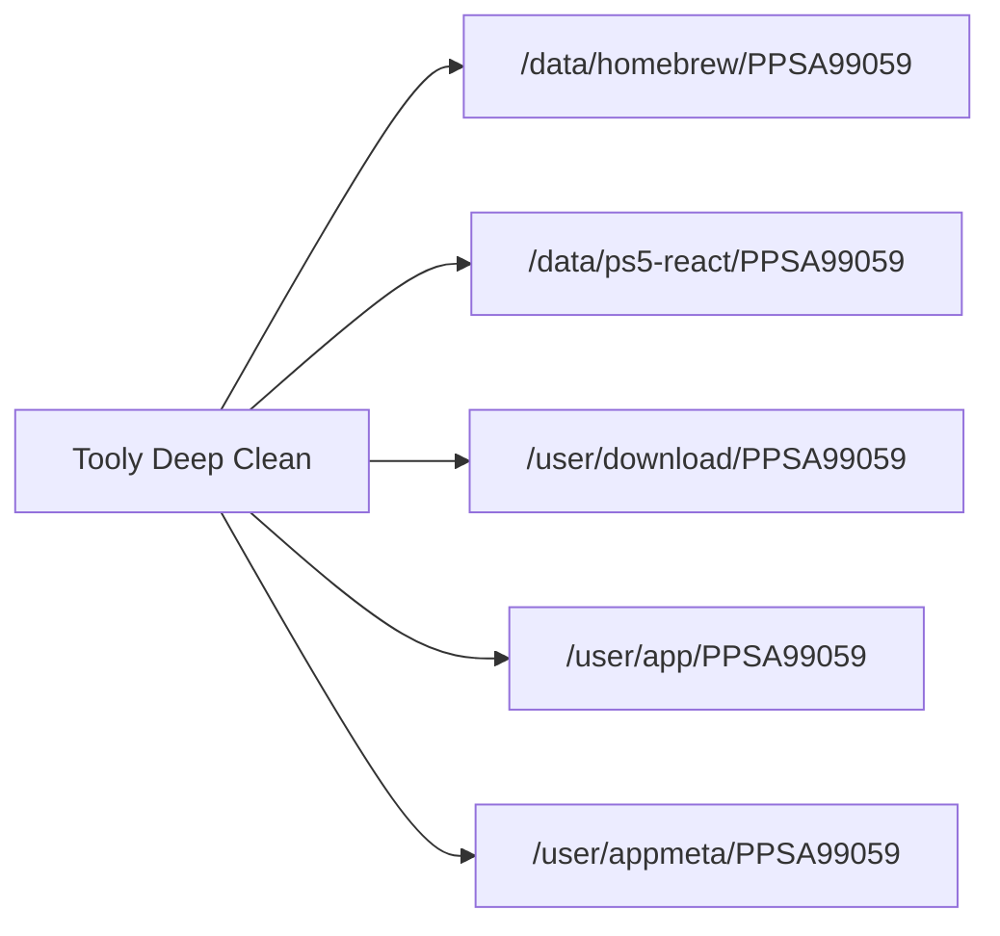
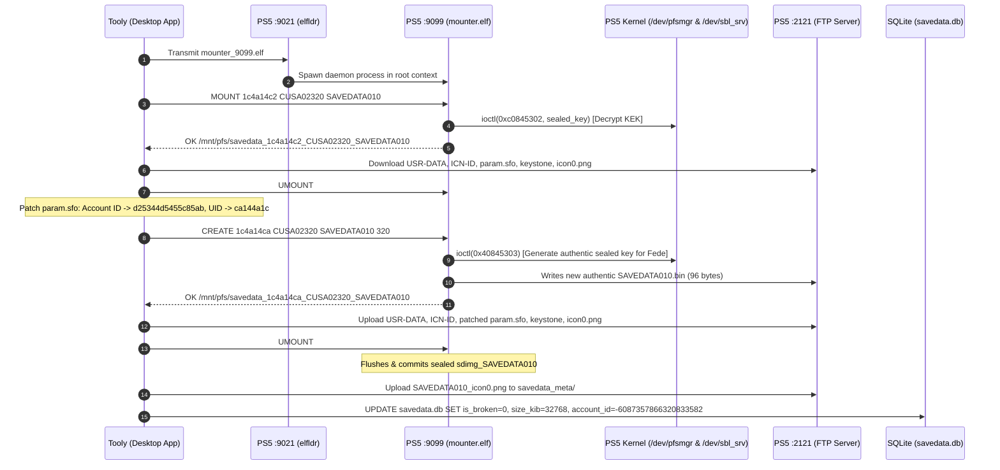

# PlayStation 5 Advanced Systems & Engineering Playbook
*A Technical Specification and Field Implementation Guide for Tooly Developers and Security Engineers*

---

## 1. Executive Summary

During intensive field testing on jailbroken PlayStation 5 retail hardware (Firmware 13.60 / etaHEN & HyperHEN environments), the Tooly engineering team researched, diagnosed, and resolved three complex systems engineering challenges:

1. **Storage Sanitation & Forensic Decontamination**: Recovered **123.77 GiB** of NVMe storage by tracing aborted asynchronous download daemons (`ava-part`), orphaned transactional database journals, and eliminating deep multi-tier homebrew debris across sandbox and system partition boundaries.
2. **Dynamic Game Backport & Runtime Library Engineering**: Eliminated critical save/load runtime crashes (**`CE-107098-5`**) in 130+ GiB backported commercial titles (*Resident Evil Requiem*, `PPSA31246`) by leveraging low-level persistent read-write block driver hooks (`ShadowMount`) to surgically isolate conflicting shared libraries (`libSceSaveData.native.sprx`) directly inside mounted exFAT disk images without unpacking or re-transferring hundreds of gigabytes over LAN.
3. **Hardware Cryptographic Save Data Resigning & Cross-Profile Migration**: Solved cross-profile save lockout and data corruption (**`is_broken = 1`**, **`CE-107109-8`**) on backwards-compatible PS4 and native PS5 saves (*Uncharted: The Nathan Drake Collection*, `CUSA02320`). Established an automated on-console pipeline utilizing the PS5 ELF loader (`elfldr` on `:9021`), deploying in-memory payload microservices (`mounter.elf` on `:9099`), communicating with the console kernel's Security Accelerator and Memory Unit (SAMU) via `/dev/pfsmgr` and `/dev/sbl_srv`, and programmatically repairing the internal system SQLite save registry (`savedata.db`).

This playbook serves as the definitive technical reference for integrating these advanced capabilities into **Tooly** (Tauri v2 + Rust + React 19).

---

## 2. PS5 System Architecture & Security Boundaries

Understanding the storage hierarchy, execution sandboxes, and cryptographic hardware is prerequisite to operating reliably on the platform.

### 2.1 Partition & Storage Taxonomy

The PS5 operating system (Prospero OS, a hardened FreeBSD 12 derivative) divides its internal NVMe storage into strictly partitioned mounts:

```text
/
├── /data/                  # Global read-write homebrew and daemon shared volume
│   ├── homebrew/           # Loose and exFAT mounted applications (PPSA99xxx)
│   ├── pldmgr/             # Payload Manager descriptors and ELF binaries
│   ├── shadowmount/        # ShadowMount block-device mount table & configs
│   └── ps5upload/          # Asynchronous upload and staging engines (AVA)
├── /user/                  # User sandbox and state partition
│   ├── app/                # System application metadata links and stubs
│   ├── appmeta/            # Game icons, splash art, and JSON descriptors
│   ├── download/           # Shell downloader temporary container chunks
│   └── home/               # Per-user profile environments (e.g., 1c4a14ca)
│       ├── savedata/       # Encrypted PS4 backwards compatibility saves
│       ├── savedata_prospero/ # Encrypted PS5 native saves
│       └── savedata_meta/  # Save data icon0.png visual metadata
└── /system_data/           # Privileged system state and databases
    └── savedata/           # Authoritative system-wide save registry databases
        └── <user_id>/db/user/savedata.db  # Critical SQLite save index
```

### 2.2 Security Processors: SAMU & Hardware Crypto

PlayStation saves are protected by two concentric cryptographic envelopes:

```mermaid
flowchart TD
    subgraph Host OS (FreeBSD Kernel)
        A["Save File (USR-DATA)"] --> B["PFS Filesystem Container (sdimg_*)"]
        B --> C["Encrypted AES-128-XTS Image"]
    end
    subgraph SAMU Hardware (Secure Crypto Processor)
        D["Unique Console Key (SNVS)"]
        E["Target Account ID (64-bit uint)"]
        D & E --> F["SAMU Keystore"]
        F -->|pfs_seal_key| G["96-Byte Sealed Blob (SAVEDATA*.bin / pfsSKKey)"]
    end
    C -.->|Decrypted via /dev/pfsmgr| G
```

* **PlayStation File System (PFS)**: An encrypted virtual filesystem container (`sdimg_<slot>`). The filesystem payload is encrypted with AES-128-XTS using a random 32-byte AES key.
* **The Sealed Key (`pfsSKKey`)**: The 32-byte AES key is cryptographically sealed into a **96-byte blob** stored in the companion `.bin` file (PS4) or at offset `0x800` inside the image (PS5).
* **The SAMU Barrier**: The seal is created by the console's **Security Accelerator & Memory Unit (SAMU)** using hardware master keys fused into the SoC combined with the user's 64-bit `Account ID`. 
  > [!IMPORTANT]
  > **Offline Impossibility**: Because the private SAMU keys never leave the secure processor, **no PC, Mac, or offline script can cryptographically re-sign a raw `.bin` sealed key**. Re-signing requires issuing kernel syscalls to the running console hardware (`/dev/pfsmgr` or `/dev/sbl_srv`).

---

## 3. Storage Forensics & Package Hygiene Engine

### 3.1 Forensic Analysis of Aborted Large Downloads (`.ava-part`)

When massive packages (e.g. 130+ GB games) are transferred via PS5 remote upload daemons (`PS5Upload.app` / `ava-engine`), unexpected network drops or out-of-space conditions leave giant orphaned fragments that standard homebrew launchers fail to identify.

#### Diagnostic Signature
* **Target Path**: `/data/homebrew/<TitleID>.exfat.ava-part`
* **Journal Logs**: `/data/ps5upload/ava/events.log`
* **Symptom**: `events.log` records repetitive failures:
  ```json
  {"level":"error","msg":"write /data/homebrew/PPSA31246.exfat.ava-part: no space left on device"}
  ```
* **Orphaned State**: The AVA database locks a transactional job in `/data/ps5upload/ava/jobs/<UUID>/` containing `manifest`, `journal`, and block parts (`0.ob`).

#### Remediation Protocol
To reclaim storage without rebooting or risking database corruption:
1. Identify the running upload engine PID via FTP process scan or socket disconnect.
2. Delete the `.ava-part` multi-gigabyte file:
   ```text
   DELE /data/homebrew/PPSA31246.exfat.ava-part  --> Freed 123.17 GiB
   ```
3. Purge the orphaned job folder `/data/ps5upload/ava/jobs/<UUID>/`.
4. Truncate rotating daemon logs (`PS5SXHelper.log.1`, `.2`, `.3`).

### 3.2 Deep Package Deletion Pipeline

Commercial stores or complex homebrew (such as *Padrino Store* `PPSA99059`) scatter dependencies across five distinct operating system layers. Standard deletion via UI frequently leaves hundreds of megabytes of React WebKit caches and orphaned download packages.



| Layer | Path | Nature | Impact if Left Behind |
| :--- | :--- | :--- | :--- |
| **Application Binary** | `/data/homebrew/<TID>/` | Executable, assets, and configs | Consumes 50–500 MB; prevents clean re-installation |
| **React / WebKit Cache**| `/data/ps5-react/<TID>/` | Unpacked Node/Vite web runtime | Thousands of small chunk files (inode exhaustion) |
| **Download Chunk Store**| `/user/download/<TID>/` | `download0.dat` chunks | Retains multi-hundred MB staging buffers |
| **Shell Stub** | `/user/app/<TID>/` | OS executable launch target | Causes "ghost icons" or launch errors on dashboard |
| **Metadata & Artwork** | `/user/appmeta/<TID>/` | `icon0.png`, `param.json` | Displays broken tiles in PS5 Home Menu |

---

## 4. Game Backport & Runtime Library Conflict Engineering

### 4.1 Root Cause Analysis: Error `CE-107098-5`

When games compiled for newer PlayStation SDK versions (e.g., SDK 13.60+) are backported to run on exploited firmware, release groups package replacement `.sprx` modules inside a `/fakelib/` directory within the game image.

```text
Game Container (PPSA31246.exfat)
└── fakelib/
    ├── libSceAgc.sprx              # CRITICAL: Graphics backport module (MUST KEEP)
    ├── libScePsml.sprx             # CRITICAL: Shading language runtime (MUST KEEP)
    └── libSceSaveData.native.sprx  # CONFLICT: Overrides native save services
```

* **The Failure**: `libSceSaveData.native.sprx` attempts to emulate newer save compression routines (LZ4/Zstd pipelines). On exploited firmware with functional system save daemons, this custom library fails with:
  ```text
  Error CE-107098-5 (Save Data Mount / Initialization Failure)
  ```
  The game refuses to detect existing saves and boots only to "New Game".
* **The Pitfall**: Completely disabling `fakelib` (via `fakelib_mode=PPSA31246:disabled` in `config.ini`) causes the graphics engine to crash instantly on boot because `libSceAgc.sprx` is missing.

### 4.2 Non-Destructive Live Patcher Protocol

Traditional workflows require unpacking the 132 GB `.exfat` container on a PC, deleting the module, and transferring 132 GB back to the console. 

**The Tooly In-Situ Solution**:
1. Configure `ShadowMount` (`/data/shadowmount/config.ini`) to mount the disk image in persistent **Read-Write** mode:
   ```ini
   [options]
   mount_read_only=0
   persistent_image_mounts=1
   image_rw=PPSA31246.exfat
   ```
2. ShadowMount attaches the container to `/mnt/shadowmnt/PPSA31246_<UUID>/` with write permissions enabled.
3. Perform an atomic rename over FTP:
   ```text
   RNFR /mnt/shadowmnt/PPSA31246_41be8591/fakelib/libSceSaveData.native.sprx
   RNTO /mnt/shadowmnt/PPSA31246_41be8591/fakelib/libSceSaveData.native.sprx.bak
   ```
4. **Result**: The game falls back to the native, fully stable PS5 operating system save libraries while continuing to load `libSceAgc.sprx` for graphics rendering.

---

## 5. Savegame Cryptography & Cross-Profile Resigning Engine

### 5.1 The Anatomical Difference: PS4 vs PS5 Saves on PS5

| Attribute | PS4 Save on PS5 (`CUSAxxxxx`) | PS5 Native Save (`PPSAxxxxx`) |
| :--- | :--- | :--- |
| **Save Directory** | `/user/home/<uid>/savedata/<TitleID>/` | `/user/home/<uid>/savedata_prospero/<TitleID>/` |
| **Container File** | `sdimg_<slot>` (PFS format) | `sdimg_<slot>` or `<slot>` (Prospero PFS format) |
| **Sealed Key Location** | Dedicated companion `<slot>.bin` (96 bytes) | Embedded at offset `0x800` inside the image |
| **Metadata Descriptor** | Binary `PARAM.SFO` (`0x46535000` / `\0PSF`) | JSON `param.json` or binary SFO |
| **Metadata Visuals** | `/user/home/<uid>/savedata_meta/user/<TitleID>/<slot>_icon0.png` | Stored in `savedata_prospero_meta/user/<TitleID>/` |

### 5.2 Why Homebrew Utilities (MacheteSVG / Offline Tools) Failed

1. **Scanner Blindness**: MacheteSVG's scanner hardcoded directory search filters that failed to register titles whose folder names or database indexes did not match strict uppercase naming conventions.
2. **Missing SAMU Key Generator**: MacheteSVG's internal "Apollo Mode" only modified the plaintext `param.sfo` and copied the `keystone` file. It **failed to generate a new hardware-sealed `.bin` key** for the target profile.
3. **Database Flag `is_broken = 1`**: When the PS5 kernel attempts to load a save whose `.bin` key cannot be authenticated by SAMU for the active account, it sets `is_broken = 1` inside `/system_data/savedata/<uid>/db/user/savedata.db`. Once this bit is set, the OS refuses to mount the container ever again until manually repaired.

### 5.3 The On-Console In-Memory Microservice: `mounter.elf`

To perform legitimate cryptographic signing, Tooly leverages `mounter.elf` (Playstation-5-Save-Mounter by *n0llptr*), which hooks into kernel drivers.

#### Dynamic Port Relocation
By default, `mounter.elf` binds to port `9090`. However, existing jailbreak daemons (such as etaHEN's JSON server or WebKit listener) frequently occupy `9090`.
* **Binary Patch**: Locate instruction at offset `0x4144`:
  ```text
  Original:  66 c7 45 be 23 82   -->  mov word [rbp-0x42], htons(9090)
  Patched:   66 c7 45 be 23 8b   -->  mov word [rbp-0x42], htons(9099)
  ```
* **Payload Injection**: Transmit the patched ELF to the kernel loader at `192.168.1.17:9021`.

#### Socket Command Protocol Specification
Once deployed, `mounter.elf` exposes a fast ASCII protocol on port `9099`:

| Command | Arguments | Response | Description |
| :--- | :--- | :--- | :--- |
| `PING` | None | `OK` | Health check / heartbeat |
| `GET_FW` | None | `OK <version>` | Returns detected kernel firmware (e.g. `13.60`) |
| `GET_USERS` | None | `OK <count>\n<uid> <name>...` | Returns list of logged-in local users |
| `SEARCH` | `<uid> <TitleID>` | `OK <count>\n<slot>\t<title>...` | Scans savedata directories for slots |
| `MOUNT` | `<uid> <TitleID> <slot>` | `OK /mnt/pfs/<mount_path>` | Calls SAMU to decrypt key and mounts PFS |
| `CREATE` | `<uid> <TitleID> <slot> <blocks>` | `OK /mnt/pfs/<mount_path>` | **Generates authentic SAMU key**, allocates PFS & mounts |
| `UMOUNT` | None | `OK` | Flushes filesystem, commits crypto, and cleans mount |

### 5.4 Complete End-to-End Save Resigning Workflow



#### Step-by-Step Mathematical & Binary Operations:

1. **Mount Source Save**:
   Send `MOUNT 1c4a14c2 CUSA02320 SAVEDATA010`. The source PFS filesystem is exposed in plaintext at `/mnt/pfs/savedata_1c4a14c2_CUSA02320_SAVEDATA010/`.
2. **Harvest Payload & Metadata**:
   Download `USR-DATA` (save state), `ICN-ID`, `sce_sys/param.sfo`, `sce_sys/icon0.png`, `sce_sys/keystone`, `sce_sys/sce_paramsfo1`, and `sce_sys/sce_icon0png1`.
3. **Unmount Source**:
   Send `UMOUNT`.
4. **Binary SFO Resigning**:
   In the binary `param.sfo`:
   * Locate 8-byte `ACCOUNT_ID` value (`decdf0167032de29` in little-endian) and replace with target account (`d25344d5455c85ab`).
   * Locate `PARAMS` table (offset `+0x04` inside `PARAMS` contains the 4-byte local user ID). Replace `c2 14 4a 1c` (`0x1c4a14c2`) with `ca 14 4a 1c` (`0x1c4a14ca`).
   * Preserve the 32-byte OpenPSID HMAC unchanged (as the console hardware is identical).
5. **Hardware Container Generation**:
   Send `CREATE 1c4a14ca CUSA02320 SAVEDATA010 320`.
   * `mounter.elf` invokes `ioctl(fd, 0x40845303, keybuf)` on `/dev/sbl_srv` to generate an authentic 96-byte `pfsSKKey` sealed for user `1c4a14ca`.
   * Saves `/user/home/1c4a14ca/savedata/CUSA02320/SAVEDATA010.bin`.
   * Formats a 32 MB container image and mounts it at `/mnt/pfs/savedata_1c4a14ca_CUSA02320_SAVEDATA010/`.
6. **Inject Decrypted Payload & SFO**:
   Via FTP, write `USR-DATA`, `ICN-ID`, and create `sce_sys/` containing the patched `param.sfo`, `icon0.png`, `keystone`, `sce_paramsfo1`, and `sce_icon0png1`.
7. **Commit Container**:
   Send `UMOUNT`. The image is cleanly unmounted and atomically committed to `/user/home/1c4a14ca/savedata/CUSA02320/sdimg_SAVEDATA010`.
8. **Repair SQLite `savedata.db`**:
   Fetch `/system_data/savedata/1c4a14ca/db/user/savedata.db` and execute:
   ```sql
   UPDATE savedata SET 
       is_broken = 0,
       fake_broken = 0,
       size_kib = 32768,
       blocks = 320,
       free_blocks = 270,
       account_id = -6087357866320833582,
       user_id = 474617034,
       tmp_dir_name = '',
       mtime = '2026-10-25T21:24:00.00Z'
   WHERE title_id = 'CUSA02320' AND dir_name = 'SAVEDATA010';
   ```
   *(Note: `-6087357866320833582` is the signed 64-bit integer representation of `0xab855c45d54453d2` / `d25344d5455c85ab`).*
9. **Deploy User Visual Metadata**:
   Upload `icon0.png` to `/user/home/1c4a14ca/savedata_meta/user/CUSA02320/SAVEDATA010_icon0.png`.

---

## 6. Tooly Architecture & Next-Gen Implementation Guide

To bring these capabilities natively into Tooly's desktop interface, implement three new modules in `src-tauri/src/modules/`:

### 6.1 Module 1: `storage_cleaner.rs`

```rust
// Proposed Rust struct for Storage Sanitation in Tooly
use serde::{Deserialize, Serialize};

#[derive(Debug, Clone, Serialize, Deserialize)]
pub struct OrphanedArtifact {
    pub path: String,
    pub title_id: Option<String>,
    pub artifact_type: ArtifactType,
    pub size_bytes: u64,
}

#[derive(Debug, Clone, Serialize, Deserialize)]
pub enum ArtifactType {
    AbortedAvaDownload,
    AvaJobFolder,
    ReactChunkCache,
    RotatedDaemonLog,
    GhostAppStub,
}

pub struct StorageCleanerService;

impl StorageCleanerService {
    pub async fn scan_storage_leaks(ftp: &mut AsyncFtpStream) -> Result<Vec<OrphanedArtifact>, ToolyError> {
        // 1. Scan /data/homebrew/ for *.ava-part
        // 2. Scan /data/ps5upload/ava/jobs/ for stale UUIDs
        // 3. Scan /data/ps5-react/ for deleted Title IDs
        // 4. Return audit items with reclaimable byte counts
        todo!()
    }

    pub async fn execute_purge(ftp: &mut AsyncFtpStream, items: Vec<OrphanedArtifact>) -> Result<u64, ToolyError> {
        // Atomic DELE commands handling FTP 226/250 response codes safely
        todo!()
    }
}
```

### 6.2 Module 2: `shadowmount_patcher.rs`

```rust
// Proposed Rust struct for Live ExFAT Container Patching in Tooly
pub struct ShadowMountService;

impl ShadowMountService {
    pub async fn set_container_rw(ftp: &mut AsyncFtpStream, image_name: &str) -> Result<(), ToolyError> {
        // 1. Read /data/shadowmount/config.ini
        // 2. Set mount_read_only=0, persistent_image_mounts=1, image_rw=<image_name>
        // 3. Upload updated config and signal daemon reload
        todo!()
    }

    pub async fn patch_fakelib_module(
        ftp: &mut AsyncFtpStream,
        mounted_path: &str,
        module_name: &str,
    ) -> Result<(), ToolyError> {
        // RNFR <mounted_path>/fakelib/<module_name>
        // RNTO <mounted_path>/fakelib/<module_name>.bak
        todo!()
    }
}
```

### 6.3 Module 3: `save_resigner.rs`

```rust
// Proposed Rust orchestration service for On-Console Save Resigning
use tokio::net::TcpStream;
use tokio::io::{AsyncReadExt, AsyncWriteExt};

pub struct SaveResignerService {
    ps5_ip: String,
    elfldr_port: u16,  // 9021
    mounter_port: u16, // 9099
}

impl SaveResignerService {
    pub async fn deploy_mounter_payload(&self, patched_elf_bytes: &[u8]) -> Result<(), ToolyError> {
        let mut stream = TcpStream::connect(format!("{}:{}", self.ps5_ip, self.elfldr_port)).await?;
        stream.write_all(patched_elf_bytes).await?;
        stream.shutdown().await?;
        tokio::time::sleep(tokio::time::Duration::from_millis(1500)).await;
        Ok(())
    }

    pub async fn resign_ps4_save(
        &self,
        source_uid: u32,
        target_uid: u32,
        target_account_id: u64,
        title_id: &str,
        slot_name: &str,
        blocks: u64,
    ) -> Result<(), ToolyError> {
        // 1. Connect to mounter_port (9099)
        // 2. Execute MOUNT source -> extract payload via FTP
        // 3. Execute UMOUNT source
        // 4. Patch PARAM.SFO in memory
        // 5. Execute CREATE target -> inject payload via FTP
        // 6. Execute UMOUNT target
        // 7. Update SQLite savedata.db (set is_broken = 0)
        // 8. Deploy metadata icon0.png
        todo!()
    }
}
```

---

## 7. Network Protocol & Port Reference Guide

| Port | Protocol | Service / Daemon | Operational Role |
| :--- | :--- | :--- | :--- |
| **`2121`** | FTP | `ftps5` / HyperHEN FTP | High-speed file exploration, transfers, and metadata manipulation. *(Note: Handles `226 File deleted` responses).* |
| **`9021`** | Raw TCP Stream | `elfldr.elf` (John Törnblom) | On-console root payload execution. Transmit raw ELF binary and close send-half (`SHUT_WR`). |
| **`9090`** | TCP Socket | etaHEN / WebKit Server | Default jailbreak daemon and JSON command socket. |
| **`9099`** | TCP Socket | `mounter.elf` (Patched) | High-speed save mounting & SAMU key generation microservice. |
| **`8383`** | HTTP / REST | MacheteSVG Web Station | Web browser save management interface with QR Code integration. |
| **`12800`**| HTTP / REST | etaHEN Direct Package Installer | Remote PKG trigger over LAN via HTTP POST JSON. |

---

## 8. Forensic Troubleshooting & Error Codes

### `CE-107098-5`
* **Subsystem**: Prospero Save Data Service (`libSceSaveData`).
* **Root Cause**: Incompatible backported `libSceSaveData.native.sprx` inside `/fakelib/` attempting to emulate save compression pipelines on exploited firmware.
* **Fix**: Configure `ShadowMount` in `image_rw` mode and rename the module to `.bak`.

### `CE-107109-8`
* **Subsystem**: Save Data Kernel Validation / SAMU Cryptography.
* **Root Cause**: Attempting to load save data belonging to another user profile or another console without matching SAMU sealed key credentials.
* **Fix**: Do not perform raw filesystem copies. Mount source via `mounter.elf`, extract decrypted files, issue `CREATE` to generate target SAMU keys, and repair `savedata.db`.

### `is_broken = 1` in `savedata.db`
* **Subsystem**: System SQLite Save Registry.
* **Root Cause**: System detected a missing `.bin` companion file, an unsealed key mismatch, or an interrupted write.
* **Fix**: Re-seal container, repair row in SQLite `savedata.db` setting `is_broken = 0`, `fake_broken = 0`, and recalculate `size_kib`.

### FTP Error `502 Command not recognized` on `NLST`
* **Subsystem**: `ftps5` Minimal FTP Implementation.
* **Root Cause**: The embedded PS5 FTP server does not support RFC 959 `NLST`.
* **Fix**: Always issue `LIST <path>` and parse directory items from standard UNIX style listing lines.

### FTP Error `550 Read-only filesystem` on `/mnt/shadowmnt/`
* **Subsystem**: FreeBSD VFS Mount Options.
* **Root Cause**: `mount_read_only=1` set in `/data/shadowmount/config.ini`.
* **Fix**: Set `mount_read_only=0`, `persistent_image_mounts=1`, specify `image_rw=<image_name>`, and reload ShadowMount.

---

*Authored by Antigravity Technical Documentation Architecture (docs-architect)*  
*Project: Tooly (PlayStation 5 Companion Application)*  
*Repository: `/Users/fede/Dev/Projects/tooly`*
